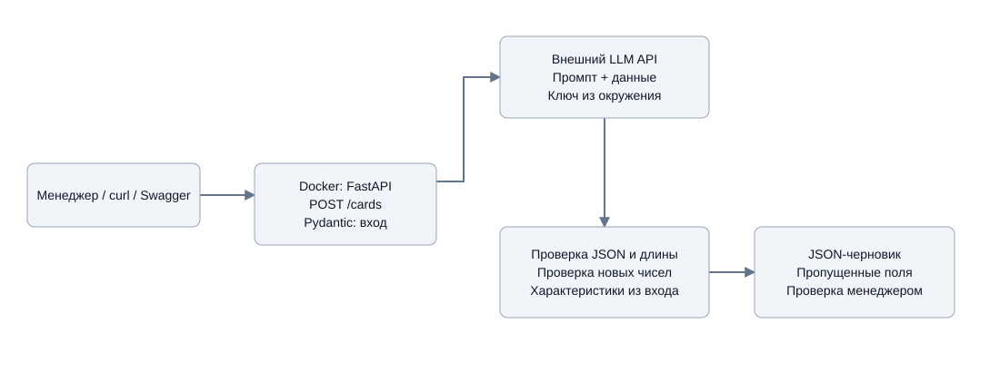

# ТЗ: генерация товарных описаний

Сервис подготовки черновиков карточек измерительных приборов по данным товара.

## Стек

Python 3.11, FastAPI, Pydantic, HTTPX, uv, Docker. Тесты - pytest, проверка кода - Ruff.

## Запуск

Установите uv. Скопируйте `.env.example` в `.env`, заполните `LLM_API_KEY`, `LLM_BASE_URL` и `LLM_MODEL`.

```sh
uv sync --locked
uv run uvicorn product_writer.app:app
```

Сервис слушает порт 8000. Форма запросов - `/docs`, генерация - `POST /cards`. Примеры входных JSON находятся в `examples/`.

## Docker

```sh
docker compose up --build -d
docker compose ps
docker compose logs --tail=100 api
```

Настройки берутся из `.env`, зависимости - из `uv.lock`. Порт доступен только на машине запуска. Остановка: `docker compose down`.

## Проверки

```sh
uv run pytest -q
uv run ruff check .
uv run ruff format --check .
```

GitHub Actions выполняет проверки, собирает образ и проверяет запуск контейнера. `main` - основная ветка, `dev` - разработка.

## Данные

Товары DT-133 и VA6502 взяты из [фида СОЮЗ-ПРИБОР](https://souz-pribor.ru/yml/any/feed.xml) 03.11.2026. Исходные записи, входные JSON и примеры карточек сохранены в `examples/`.

В выбранных записях нет технических характеристик: пропуски отмечены как «данных нет». Примеры подготовлены вручную, не вызовом LLM. Для генерации нужен ключ провайдера; тесты работают без него.

## Схема



Исходник Draw.io и решения по архитектуре находятся в `docs/`.
